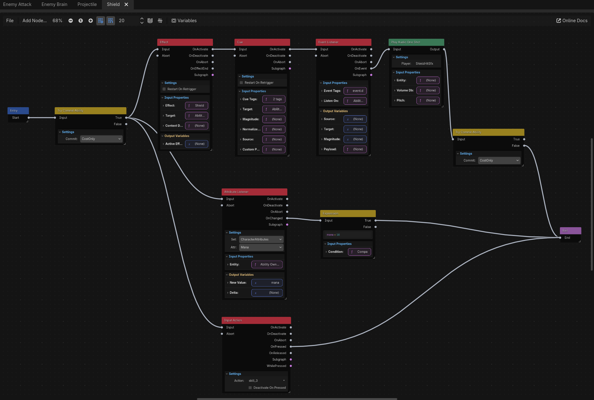
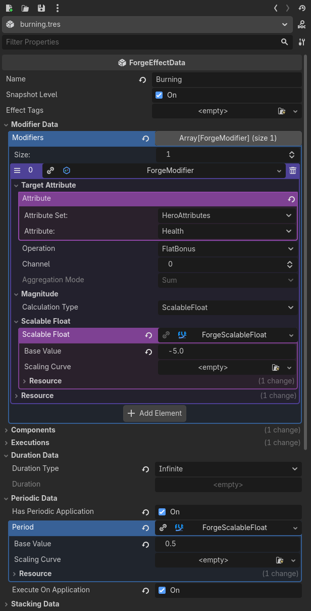
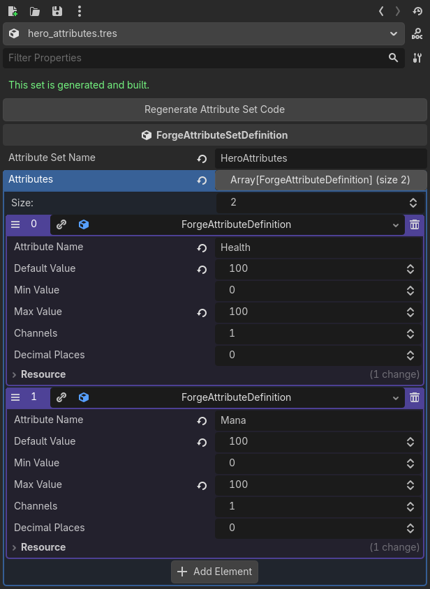
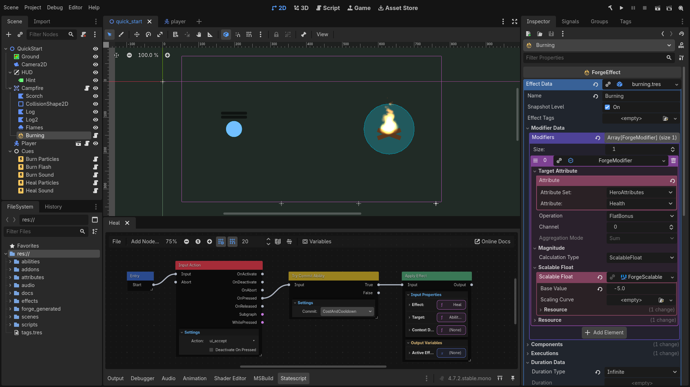
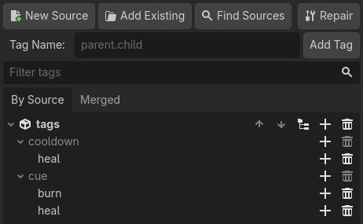
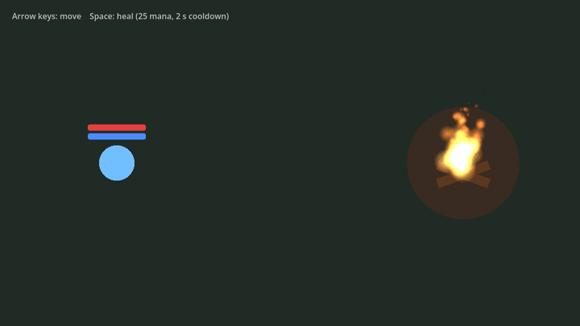
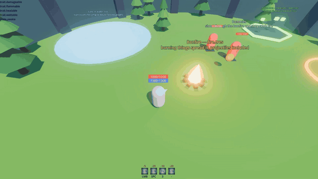

# Forge for Godot

**A gameplay framework for Godot, bringing Unreal’s Gameplay Ability System concepts to Godot.** Attributes, effects, abilities, gameplay tags, events and cues, configured in the Inspector and scripted visually with Statescript graphs.

https://github.com/user-attachments/assets/01f66ab9-999f-4593-9b36-a7138bdfef85

Forge for Godot brings the engine-agnostic [Forge Gameplay System](https://github.com/gamesmiths-guild/forge) into Godot as nodes, resources and editor tools. A burning floor, a dash with a cooldown, a shield that drains mana, an enemy that chases and attacks: you build these from data and graphs, so they stay readable as your game grows.

## What it looks like

### Abilities as graphs

Statescript is a visual, state-based scripting system for ability behavior. This is the shield from the samples: commit the mana cost, apply damage reduction, show the bubble, pay again on every hit, and drop when mana runs low or the key is pressed again. No C#.

Built-in nodes reach the scene, physics, navigation, input, animation and audio, so a dash, a projectile or a spawner can be authored rather than coded. See [Statescript](docs/statescript/README.md).

The dash, running next to its graph:

https://github.com/user-attachments/assets/7ee8bfe0-ae47-42ea-8988-a500ff96c49b

### Gameplay data in the Inspector

Effects, abilities, cues and attribute sets are resources. A damage-over-time effect is a few fields: a modifier, a duration, a period.

Attribute sets can be written in C# or described in the Inspector, and the plugin generates the class for you. See [Attribute Set Definitions](docs/attribute-set-definitions.md).

### Nodes that fit Godot

Add a `ForgeEntity` to any node to give it attributes, tags, effects and abilities. `EffectArea2D/3D`, `EffectRayCast2D/3D`, `EffectShapeCast2D/3D` and `ForgeProjectile2D/3D` apply effects through physics. Ready-made cue handlers play particles, sounds, animations, camera shake and hit stop when an effect says so.

### Tags you can manage

Hierarchical gameplay tags (`cue.burn`, `cooldown.skill.dash`) drive requirements, immunities, cooldowns and cue routing. The **Tags** dock edits them across several source files and repairs broken references. See [Gameplay Tags](docs/gameplay-tags.md).

## Get started

1. Install **Forge Gameplay System** from the editor's **Asset Store** tab, or grab the `.zip` from the [latest release](https://github.com/gamesmiths-guild/forge-godot/releases/latest). The [installation guide](docs/installation.md) has the details.
2. Build, then enable the plugin under **Project Settings → Plugins**.
3. Follow the **[Quick Start](docs/quick-start.md)**: a character, a campfire that burns and a heal ability in about fifteen minutes.

Requires **Godot 4.7+ .NET** and the **.NET 8 SDK** or later. Forge is C# only.

## Samples

The optional `forge_samples` folder holds playable demos. Open `forge_samples/Main.tscn` and pick one from the hub:

| Demo | What it shows |
| --- | --- |
| **Quick Start** | The finished result of the Quick Start guide. |
| **Real-Time 3D** | A character with dash, projectile, shield and reflect, enemies, and fire, water and regen areas, with every ability written in C#. |
| **Turn-Based 2D** | The same effects on a board where time only moves when you do, and a node that implements `IForgeEntity` itself. |
| **Statescript** | The Real-Time 3D demo rebuilt with every ability and the enemy AI as Statescript graphs, plus enemy waves, spreading fire, sounds and juice. |

The samples use their own tag source. Add it once from the **Tags** dock with **Find Sources** (see [Sample Project](docs/installation.md#sample-project)).

## Documentation

- [Quick Start](docs/quick-start.md) and [Installation](docs/installation.md)
- [Documentation overview](docs/README.md): architecture and how the pieces fit
- [Forge Nodes](docs/nodes.md) and [Forge Resources](docs/resources.md)
- [Statescript](docs/statescript/README.md): graphs, variables, subgraphs, the [node library](docs/statescript/nodes/README.md) and [resolvers](docs/statescript/resolvers/README.md)
- [Gameplay Tags](docs/gameplay-tags.md), [Attribute Set Definitions](docs/attribute-set-definitions.md) and [Helper Classes](docs/helper-classes.md)
- [Core Forge documentation](https://github.com/gamesmiths-guild/forge/blob/main/docs/README.md): the concepts behind it all

## Project status

⚠️ **Work in progress.** Forge is under active development and its API may still change between releases.

**Available:** attributes, effects, tags, abilities, events, cues, Statescript with its editor and Godot node library, attribute set definitions, effect areas, casts and projectiles, the cue handler library, and the tags editor.

**Planned:** multiplayer, with network replication for all systems, and more samples.

## Debugging

The Forge NuGet package ships with [Source Link](https://learn.microsoft.com/en-us/dotnet/standard/library-guidance/sourcelink) and symbols, so you can step into Forge's source while debugging. See [Debugging](docs/README.md#debugging).

## Contributing

This project is not currently accepting contributions as it's still in early development. If you have suggestions or questions, feel free to reach out through GitHub issues or discussions.

## License

Copyright © Gamesmiths Guild. See [LICENSE](LICENSE) for details.

Third-party code included in this project is listed in [THIRD-PARTY-NOTICES](THIRD-PARTY-NOTICES.md), along with the licenses it is used under.
