# Quick Start

In about fifteen minutes you'll build a small 2D scene with Forge. It has a character with Health and Mana, a campfire that burns them, and a heal on the Space key. Almost all of it is resources and nodes made in the Godot editor. The only C# is two short scripts that move the character and draw its bars.


The finished version ships with the samples as **Demo 00 — Quick Start** (`forge_samples/demos/00_quick_start/`). Open it whenever you want to compare.

- [Before you start](#before-you-start)
- [Part 1 — A character that burns](#part-1--a-character-that-burns)
- [Part 2 — A heal ability in Statescript](#part-2--a-heal-ability-in-statescript)
- [Where to go next](#where-to-go-next)

> **Coming from code?** Every step has a collapsed **Prefer C#?** note showing the code equivalent. Resources and code can be mixed freely, so use whichever fits each piece. To build the same character entirely in C#, with no engine, follow the [core Quick Start](https://github.com/gamesmiths-guild/forge/blob/main/docs/quick-start.md).

## Before you start

You need **Godot 4.7+ .NET** and the **.NET 8 SDK** or later. Install **Forge Gameplay System** from the editor's **Asset Store** tab, build once, and enable the plugin under **Project Settings → Plugins**. The [installation guide](installation.md) has the details.

Forge works on any node, but this guide assumes a fresh 2D project. Create the folders `attributes/`, `effects/`, `abilities/`, `scenes/` and `scripts/` to match the sample's layout.

## Part 1 — A character that burns

### 1. Register the tags

Forge identifies things with **gameplay tags**: dot-separated names like `cue.burn` that live in tag source resources. Open the **Tags** dock, click **New Source** to create `tags.tres`, then add three tags with the **Tag Name** field: `cue.burn`, `cue.heal` and `cooldown.heal`.


Part 1 only needs `cue.burn`. The other two are for Part 2. [Gameplay Tags](gameplay-tags.md) covers sources, the merged view and repairs.

### 2. Describe Health and Mana

Stats live in an **attribute set**. You can describe one in the Inspector and let the plugin write the class.

1. In the FileSystem dock, right-click `attributes/` and choose **Create New → Resource → ForgeAttributeSetDefinition**. Save it as `hero_attributes.tres`.
2. Set **Attribute Set Name** to `HeroAttributes`.
3. Add two **Attributes**: `Health` and `Mana`, each with **Default Value** `100` and **Max Value** `100`.
4. Save, then click **Build** (top right of the editor). The banner turns green once the class exists.

> **Imported the samples?** The Quick Start sample already defines `HeroAttributes`, and two sets can't share a name. Skip this step and use the sample's definition, `forge_samples/demos/00_quick_start/attributes/hero_attributes.tres`.


Attribute values are integers, which keeps the simulation deterministic. For a stat that needs decimals, set **Decimal Places**: a `Speed` of `475` with two decimal places reads as `4.75`. See [Attribute Set Definitions](attribute-set-definitions.md).

<details>
<summary><b>Prefer C#?</b> Write the attribute set as a class.</summary>

```csharp
using Gamesmiths.Forge.Attributes;

public class HeroAttributes : AttributeSet
{
    public EntityAttribute Health { get; private set; }

    public EntityAttribute Mana { get; private set; }

    public HeroAttributes()
    {
        // Current, minimum and maximum values.
        Health = InitializeAttribute(nameof(Health), 100, 0, 100);
        Mana = InitializeAttribute(nameof(Mana), 100, 0, 100);
    }
}
```

Use one approach or the other for a given set name, not both.
</details>

### 3. Build the player

Create `scenes/player.tscn` with this tree:

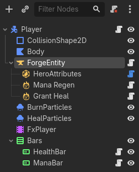

| Node | Type | Setup |
| --- | --- | --- |
| `Player` | `CharacterBody2D` | Attach `scripts/QuickStartPlayer.cs` (below). Set **Motion Mode** to *Floating*, since this is top-down. |
| `CollisionShape2D` | `CollisionShape2D` | A `CircleShape2D` with radius `22`. |
| `Body` | `Polygon2D` | Anything visible. The sample uses a light-blue circle. |
| `ForgeEntity` | `ForgeEntity` | The node that makes `Player` a Forge entity. |
| `HeroAttributes` | `ForgeAttributeSet` | Child of `ForgeEntity`. Set **Attribute Set Class** to `HeroAttributes`. |

Choosing the class fills in **Initial Attribute Values** from the definition. Edit them per scene if this character should start differently.

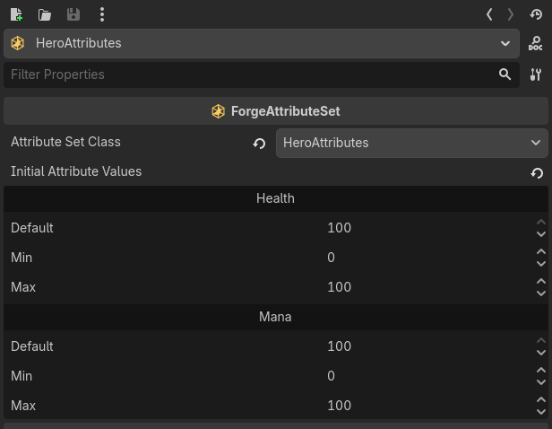

The movement script is plain Godot and doesn't touch Forge:

```csharp
using Godot;

public partial class QuickStartPlayer : CharacterBody2D
{
    [Export]
    public float Speed { get; set; } = 250;

    public override void _PhysicsProcess(double delta)
    {
        Velocity = Input.GetVector("ui_left", "ui_right", "ui_up", "ui_down") * Speed;
        MoveAndSlide();
    }
}
```

**Show the bars.** Forge keeps gameplay state out of the UI, so drawing a bar is your game's job. It takes one event subscription. Add a `VBoxContainer` named `Bars` *below* `ForgeEntity` (so the entity is ready first). Give it two `ProgressBar`s, each with this script, and point **Entity** at `ForgeEntity`. Set **Attribute** to `HeroAttributes.Health` on one and `HeroAttributes.Mana` on the other.

```csharp
using Gamesmiths.Forge.Attributes;
using Gamesmiths.Forge.Godot.Nodes;
using Godot;

public partial class AttributeBar : ProgressBar
{
    [Export]
    public ForgeEntity? Entity { get; set; }

    [Export]
    public string Attribute { get; set; } = "HeroAttributes.Health";

    private EntityAttribute? _attribute;

    public override void _Ready()
    {
        if (Entity is null)
        {
            return;
        }

        _attribute = Entity.Attributes[Attribute];
        _attribute.OnValueChanged += OnAttributeChanged;
        OnAttributeChanged(_attribute, 0);
    }

    public override void _ExitTree()
    {
        if (_attribute is not null)
        {
            _attribute.OnValueChanged -= OnAttributeChanged;
        }
    }

    private void OnAttributeChanged(EntityAttribute attribute, int change)
    {
        MaxValue = attribute.Max;
        Value = attribute.CurrentValue;
    }
}
```

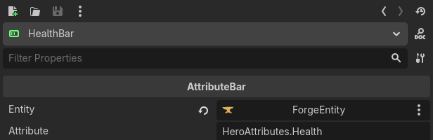

[Observing an Entity from a Godot Node](nodes.md#observing-an-entity-from-a-godot-node) covers the tag, effect and ability feeds as well.

<details>
<summary><b>Prefer C#?</b> Make the node itself the entity.</summary>

Instead of adding a `ForgeEntity` child, a node can implement `IForgeEntity` directly. That's more work, but it lets your own base class be the entity. `CustomForgeEntity.cs` in the Turn-Based 2D sample (`forge_samples/demos/02_turnbased_2d/scripts/`) is a complete example. Reading an attribute is the same either way:

```csharp
int health = forgeEntity.Attributes["HeroAttributes.Health"].CurrentValue;
```
</details>

### 4. Make fire

An **effect** changes attributes and tags. Create `effects/burning.tres` with **Create New → Resource → ForgeEffectData** and set it up:

- **Name**: `Burning`.
- **Modifiers**: add one, targeting `HeroAttributes` / `Health`. Leave the operation as *FlatBonus*, and under **Scalable Float** create a `ForgeScalableFloat` with **Base Value** `-5`.
- **Duration Type**: *Infinite*. The area in the next step removes it when you walk out.
- **Has Periodic Application**: on, with a **Period** of `0.5`. **Execute On Application**: on, so the first tick lands at once.
- **Cues**: add a `ForgeCue` whose **Cue Keys** hold `cue.burn`. The effect announces itself and step 6 decides what that looks like.


The result is 5 damage every half second for as long as the effect is active. [Resources](resources.md) documents every field, including stacking, which this guide doesn't need.

### 5. Place a campfire

Create `scenes/quick_start.tscn` with a `Node2D` root, and instance `player.tscn` into it. Then add the campfire:

| Node | Type | Setup |
| --- | --- | --- |
| `Campfire` | `EffectArea2D` | **Trigger Mode**: *OnStay*. Effects are applied on entering and removed on leaving. |
| `CollisionShape2D` | `CollisionShape2D` | A `CircleShape2D` with radius `70`. |
| `Burning` | `ForgeEffect` | Child of `Campfire`. Set **Effect Data** to `burning.tres`. |

<p>
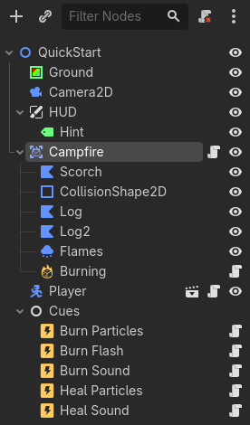
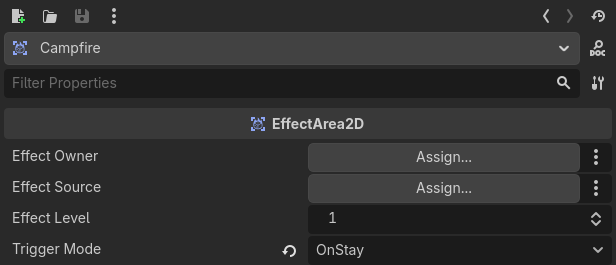
</p>

The sample's ring, logs and flames are a `Polygon2D` and a `GPUParticles2D`, purely decorative. Run the scene and walk into the fire: the Health bar drops by 5 twice a second and stops when you step out.

<details>
<summary><b>Prefer C#?</b> Apply an effect from code.</summary>

```csharp
using Gamesmiths.Forge.Effects;
using Gamesmiths.Forge.Godot.Nodes;
using Gamesmiths.Forge.Godot.Resources;
using Godot;

public partial class Trap : Area2D
{
    [Export]
    public ForgeEffectData? Burning { get; set; }

    public override void _Ready()
    {
        BodyEntered += OnBodyEntered;
    }

    private void OnBodyEntered(Node2D body)
    {
        if (body.GetNodeOrNull<ForgeEntity>("ForgeEntity") is not { } target)
        {
            return;
        }

        var effect = new Effect(Burning!.GetEffectData(), new EffectOwnership(null, null));
        ActiveEffectHandle? handle = target.EffectsManager.ApplyEffect(effect);

        // An infinite effect stays until removed: target.EffectsManager.RemoveEffect(handle).
    }
}
```

`EffectRayCast2D/3D` and `EffectShapeCast2D/3D` apply effects the same way as the area. See [Forge Nodes](nodes.md#effect-nodes).
</details>

### 6. Show it with cues

The effect raises `cue.burn` when it's applied, on every tick, and when it's removed. **Cue handlers** decide what that looks like. The plugin ships handlers for particles, sounds, animations, spawned scenes, camera shake and hit stop, so this step needs no code.

Add a plain `Node` called `Cues` to the level, and under it:

| Handler | Cue Tag | Setup |
| --- | --- | --- |
| `ParticlesCueHandler` | `cue.burn` | **Particles Path** `BurnParticles` (a `GPUParticles2D` under the player, **Emitting** off). Turn **One Shot On Execute** off: the flames burn from apply to remove instead of bursting each tick. |
| `AnimationCueHandler` | `cue.burn` | **Player Path** `FxPlayer` (an `AnimationPlayer` under the player). **Execute Animation** `hit`: a 0.2 s clip that flashes `Body:color` red. |
| `AudioCueHandler` | `cue.burn` | **Stream**: a fire loop. Turn **Play On Execute** off so the loop doesn't restart every tick. |

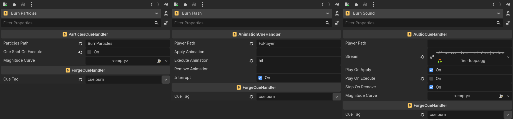

Paths are resolved from the node the target entity lives on, so one set of handlers in the level serves every entity that catches fire. Run it again:

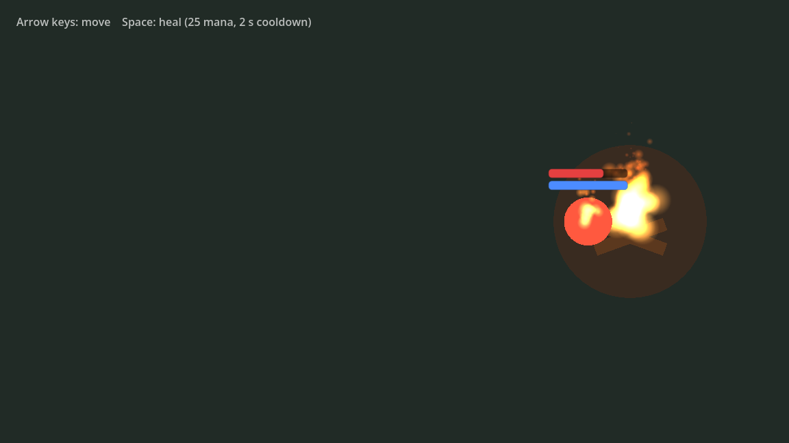

<details>
<summary><b>Prefer C#?</b> Write your own handler.</summary>

When the library doesn't cover it, extend `ForgeCueHandler` and override the phases you need:

```csharp
using Gamesmiths.Forge.Core;
using Gamesmiths.Forge.Cues;
using Gamesmiths.Forge.Godot.Nodes;
using Godot;

[GlobalClass]
public partial class DamageNumbersCueHandler : ForgeCueHandler
{
    [Export]
    public PackedScene? NumberScene { get; set; }

    public override void _CueOnExecute(IForgeEntity forgeEntity, CueParameters? parameters)
    {
        if (NumberScene is null || parameters is null || forgeEntity is not Node { } node
            || node.GetParent() is not Node2D body)
        {
            return;
        }

        var number = NumberScene.Instantiate<Label>();
        number.Text = parameters.Value.Magnitude.ToString();
        GetTree().CurrentScene.AddChild(number);
        number.GlobalPosition = body.GlobalPosition;
    }
}
```

Set a cue's **Magnitude Type** to *AttributeValueChange* and its **Magnitude Attribute** to `HeroAttributes.Health` to receive the amount of Health actually lost in `parameters.Value.Magnitude`. See [Cue Nodes](nodes.md#cue-nodes).
</details>

## Part 2 — A heal ability in Statescript

An **ability** is something an entity can do, with a cost, a cooldown, and a behavior that runs while it's active. The behavior can be a C# class or a **Statescript graph** built in the editor. This part builds the heal as a graph.

### 1. Make the effects

Four more `ForgeEffectData` resources in `effects/`, made the same way as `burning.tres`:

| Resource | Setup |
| --- | --- |
| `heal.tres` | **Instant**, `+30` to `HeroAttributes.Health`, and a cue with key `cue.heal`. |
| `heal_cost.tres` | **Instant**, `-25` to `HeroAttributes.Mana`. |
| `heal_cooldown.tres` | **HasDuration** with **Duration** `2`. Add a **ModifierTags** component whose **Tags To Add** hold `cooldown.heal`. |
| `mana_regen.tres` | **Infinite**, periodic every `1` second, `+5` to `HeroAttributes.Mana`. |

<p>
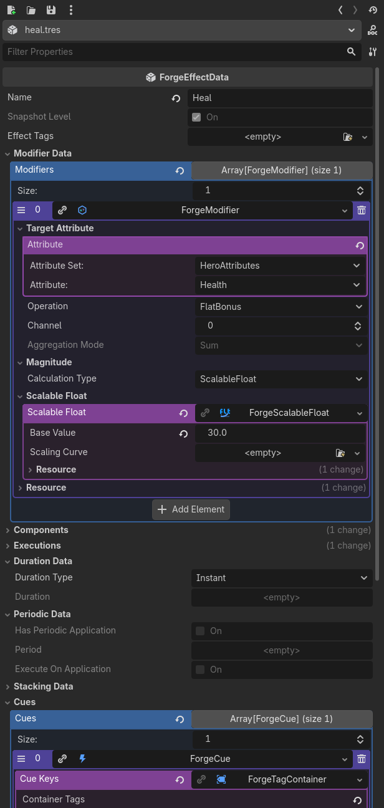
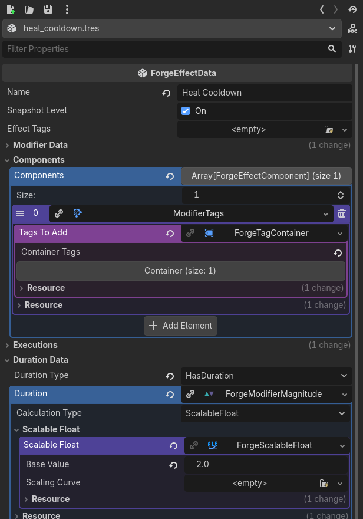
</p>

A cooldown is simply an effect that adds a tag for a while. The ability is blocked while the tag is present.

### 2. Draw the graph

Create `abilities/heal_graph.tres` as a **StatescriptGraph** resource and double-click it. The **Statescript** panel opens at the bottom of the editor. Use **Add Node…** to place three nodes after **Entry**, and wire them left to right:

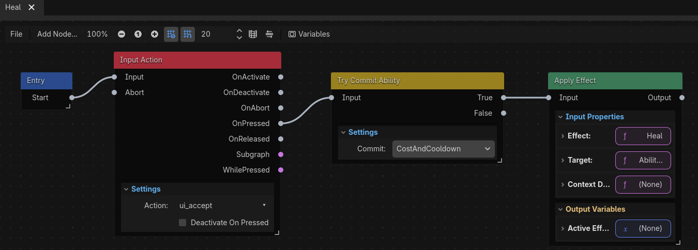

| Node | Setting | Connect |
| --- | --- | --- |
| **Input Action** (State → Input) | **Action** `ui_accept`, which is Space and Enter in every project. | Entry **Start** → **Input** |
| **Try Commit Ability** (Condition) | **Commit** *CostAndCooldown*. | Input Action **OnPressed** → **Input** |
| **Apply Effect** (Action) | **Effect** input: *Constant* with `heal.tres`. **Target** input: *Ability Owner*. | Try Commit **True** → **Input** |

Read it left to right: once the ability is running, wait for Space. On each press, try to pay 25 Mana and start the cooldown, and if that worked, heal. A failed commit, from lack of Mana or a cooldown still running, follows **False**, which isn't connected, so nothing happens.

Statescript graphs are made of **state** nodes that stay active (the Input Action keeps listening) and **action** and **condition** nodes that run instantly. The [Statescript guide](statescript/README.md) explains the model, and the [node reference](statescript/nodes/README.md) lists every node, including movement, physics, spawning and animation.

### 3. Turn it into an ability

Create `abilities/heal.tres` as a **ForgeAbilityData**:

- **Name**: `Heal`.
- **Cooldown Effects**: `heal_cooldown.tres`. **Cost Effect**: `heal_cost.tres`.
- **Ability Behavior**: a new **StatescriptAbilityBehavior** whose **Statescript** is `heal_graph.tres`.

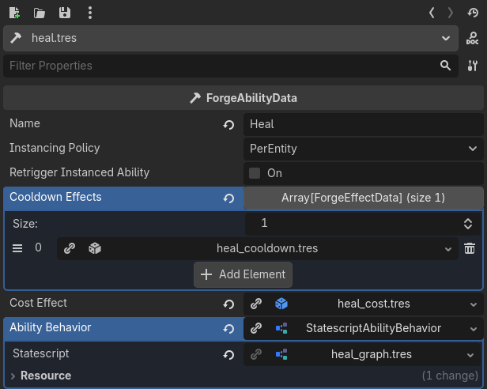

### 4. Grant it to the player

An entity has to be **granted** an ability before it can use it. The editor way is another effect: create `effects/grant_heal.tres`, **Infinite**, with a **GrantAbility** component. In its config, set **Ability Data** to `heal.tres` and turn on **Try Activate On Grant**. The graph then starts as soon as the grant lands, and its Input Action begins listening.

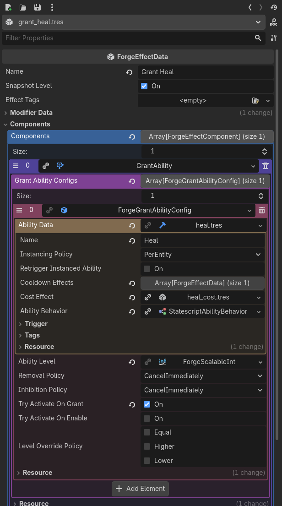

In `player.tscn`, add two `ForgeEffect` children under `ForgeEntity`: **Mana Regen** with `mana_regen.tres` and **Grant Heal** with `grant_heal.tres`. A `ForgeEffect` under an entity is applied to it when the scene is ready.

<details>
<summary><b>Prefer C#?</b> Grant and activate from code, or write the behavior in C#.</summary>

Grant permanently and keep the handle:

```csharp
using Gamesmiths.Forge.Abilities;
using Gamesmiths.Forge.Core;

AbilityHandle heal = forgeEntity.Abilities.GrantAbilityPermanently(
    HealAbility.GetAbilityData(), abilityLevel: 1, LevelComparison.None, sourceEntity: null);

// The heal graph listens for Space itself, so activate it once, right after granting.
// A one-shot C# behavior, like the one below, is activated on each press instead.
heal.TryActivate(out AbilityActivationFailures failures);
```

A behavior can be C# instead of a graph. Derive a resource from `ForgeAbilityBehavior` (with `[Tool]` and `[GlobalClass]` so the Inspector offers it) and return an `IAbilityBehavior`:

```csharp
using Gamesmiths.Forge.Abilities;
using Gamesmiths.Forge.Effects;
using Gamesmiths.Forge.Godot.Resources;
using Gamesmiths.Forge.Godot.Resources.Abilities;
using Godot;

[Tool]
[GlobalClass]
public partial class HealAbilityBehavior : ForgeAbilityBehavior
{
    [Export]
    public ForgeEffectData? Heal { get; set; }

    public override IAbilityBehavior GetBehavior() => new HealBehavior(Heal!.GetEffectData());
}

public sealed class HealBehavior(EffectData heal) : IAbilityBehavior
{
    public void OnStarted(AbilityBehaviorContext context)
    {
        if (context.AbilityHandle.TryCommitAbility())
        {
            context.Owner.EffectsManager.ApplyEffect(new Effect(heal, new EffectOwnership(context.Owner, context.Owner)));
        }

        context.InstanceHandle.End();
    }

    public void OnEnded(AbilityBehaviorContext context)
    {
    }
}
```

The Real-Time 3D sample (`forge_samples/demos/01_realtime_3d/`) implements all its abilities this way, and the Statescript sample rebuilds the same abilities as graphs, so you can compare the two.
</details>

### 5. Feedback, and play

Add two more handlers under `Cues` for `cue.heal`: a `ParticlesCueHandler` pointing at a one-shot `HealParticles` emitter on the player, and an `AudioCueHandler` with a heal sound. Run the scene, burn a little, step out and press **Space**:

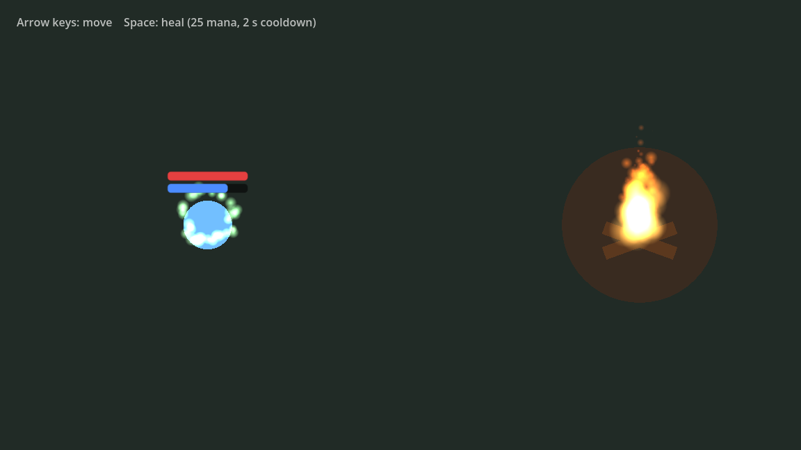

Try pressing Space twice quickly: the second press does nothing until the 2 second cooldown ends. Keep healing and Mana runs dry after about six casts, until the regen catches up.

## What you built


- **Attributes** from a definition resource, put on a node by `ForgeAttributeSet`.
- An **entity**: the `ForgeEntity` node, which owns attributes, tags, effects and abilities, and drives them every frame and physics step.
- **Effects**: an instant heal, a periodic burn, a cost, a cooldown, a regen, and an effect whose only job is to grant an ability.
- An **EffectArea2D** that applies and removes an effect by overlap.
- **Cues** that decouple what happens from how it looks and sounds.
- An **ability** with a cost and a cooldown, whose behavior is a **Statescript** graph.

## Where to go next

- Play the other samples: open `forge_samples/Main.tscn`. The Statescript demo has a dash, projectiles, a shield, enemies and waves, all as graphs. See [Sample Project](installation.md#sample-project).
- [Statescript](statescript/README.md): the graph model, variables, subgraphs and the full node library.
- [Forge Nodes](nodes.md) and [Forge Resources](resources.md): everything you can place in a scene or create in the FileSystem.
- [Gameplay Tags](gameplay-tags.md) and [Attribute Set Definitions](attribute-set-definitions.md) in depth.
- [Helper Classes](helper-classes.md) for common C# workflows.
- The [core Forge documentation](https://github.com/gamesmiths-guild/forge/blob/main/docs/README.md) explains the concepts behind all of this: how modifiers aggregate, stacking, ability lifecycles, events and more.

## Under the hood

Enabling the plugin registers a `ForgeBootstrap` autoload. It initializes the `ForgeManagers` singleton, which holds the `TagsManager` (built from your tag sources) and the `CuesManager` that routes cues to handlers:

```csharp
using Gamesmiths.Forge.Godot.Core;
using Gamesmiths.Forge.Tags;

Tag cooldown = Tag.RequestTag(ForgeManagers.Instance.TagsManager, "cooldown.heal");
bool healOnCooldown = forgeEntity.Tags.AllTags.HasTag(cooldown);
```

Forge validates its data at runtime in the editor and in debug builds. Exported release builds skip validation unless **Include Debug Symbols** is checked in the export.
